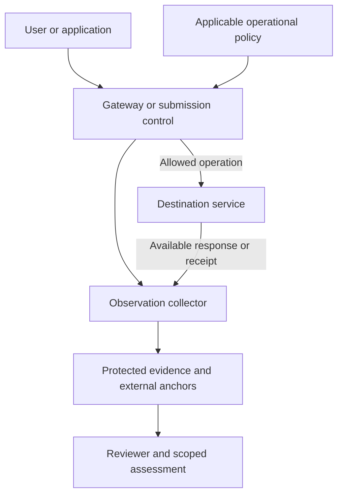

# Incident-derived evidence bindings

**Status:** Informative discussion proposal; not adopted. **Date:** 2026-10-30 JST.
**Formal proposal number:** Unassigned. **Target release:** Undecided.
**Baseline:** VAP v1.2.0 Draft 3 at `357b8e6b232750180a2a0ce185355e31880edaf6`.
**License:** CC BY 4.0 International.

This proposal connects recorded AI activity to three practical questions:

1. Was a particular transfer authorized, and what transmission was actually observed?
2. What deletion action was requested, acknowledged, claimed, or independently assessed?
3. Does a particular submitted artifact match its AI-use disclosure and applicable publication policy?

The motivation and source limitations are recorded in the [incident claim ledger](INCIDENTS.md).
The [synthetic acceptance catalogue](acceptance-cases.json) specifies proposed test inputs and expected
application-layer assessments. Those cases have not been executed against a gateway, provider, editor,
publisher, or VAP verifier. They are not an incident reconstruction or evidence of product readiness.

Repository publication or merge of this document does not adopt a standard. It introduces no new
normative event, event code, field, registered profile, conformance level, or core-verifier result.
Names and status values below are illustrative application vocabulary. Existing normative algorithms,
schemas, fixed distributions, and research gates remain separate.

## 1. Existing foundation and missing bindings

The following mapping uses the pinned [VAP baseline][vap] and [CAP baseline][cap].

| Existing mechanism | Useful foundation | Additional integration proposed here |
| --- | --- | --- |
| VAP §4.2: actor, input, context, action, outcome | Describes recorded operations | Bind the actual destination, account, payload, authorization and observation |
| VAP §4.1 and INT-008 | Checks record integrity and anchored-batch commitments | State collection coverage separately; unobserved actions are not excluded by a valid batch |
| VAP §4.3 / TRC-005 | Correlates records across independently anchored parties | Reconcile sender, provider and reviewer claims while retaining discrepancies and timeouts |
| VAP §§6.3 and 7.4: ERASURE | Records crypto-shredding of protected fields | Keep external deletion requests, acknowledgments and scoped claims distinct |
| VAP §§4.4 and 7.1 | Identifies responsible actors and verification policy | Bind an operational or publication policy and the approval to an exact operation/artifact |
| CAP GEN / EXPORT | Relates generation assets, model context and export destination | Bind revision lineage, disclosure text, policy version, approval and submission receipt |

CAP's checked-in [GEN][cap-gen] and [EXPORT][cap-export] schemas still identify themselves as v0.2
artifacts. The [existing conformance mapping][cap-mapping] describes remaining divergences with the
released v1.0 text and VAP. This proposal does not relabel those schemas or establish conformance.

The healthcare upload workflow is a cross-domain data-governance integration. Patient data in a file
does not by itself make the workflow a medical-device profile or prove any regulatory classification.
DAP may inform later delegated-agent bindings; these two incidents do not establish autonomous-agent
misconduct, and this proposal does not depend on unpublished DAP or MAP specifications.

## 2. Enforcement and evidence have separate responsibilities

The gateway, endpoint control or publishing workflow enforces the operational policy. VAP supplies
mechanisms for protecting and examining the records that this integration produces. A sidecar that
records a denial but cannot mediate the actual action cannot establish that the action was prevented.

The observation collector and signing/anchoring credentials should be administered outside the
recorded actor's write authority. A pilot needs an explicit trust model: trusted collectors and keys,
key rotation and compromise handling, anchor verification, clock uncertainty, and independent evidence
sources. Signing a false assertion preserves a false assertion; it does not make the assertion true.

XREF applies only where participating parties independently log and anchor corresponding records
under the declared matching and reconciliation rules. A local request record, an imported provider
response or access to an external service does not by itself establish TRC-005 XREF. An authenticated
imported response can still provide source-attributed evidence within its stated scope. Organizational
approval of a service and its technical participation in a provenance exchange are separate questions.

Describe records as **tamper-evident under stated trust assumptions**. Keep the observed time,
recording time, provider-claimed time and external anchoring time distinguishable. A later timestamp
does not independently establish the time of the underlying operation.

## 3. Common binding information

These are proposed information requirements for an application adapter, not a wire schema.

| Information | Binding needed for review |
| --- | --- |
| Operation identity | Unique attempt/correlation ID; relationships to earlier attempts; idempotency scope where supported |
| Actor and observation | Acting identity; collector identity; observed, imported-log, provider-asserted or self-declared evidence |
| Covered environment | Devices, applications, accounts, tenants, routes and time interval; exclusions and collector outages |
| Object identity | Opaque object ID; exact version/content commitment; transformation and parent references |
| Destination | Provider, endpoint, tenant/account, purpose and applicable organizational approval |
| Policy basis | Issuer, policy document ID/version and digest, source, effective interval, retrieval time and evaluation stage |
| Decision and result | Decision authority and expiry; actual observed dispatch/result; contradictory evidence and unknowns |
| Evidence verification | Record/receipt references; trusted key identity; required verification checks and unavailable material |

Keep three policy concepts separate: VAP's evidence-verification policy, CAP's content-safety policy,
and the organization/publisher's operational policy. Proposed fields such as `operational_policy_ref`
or `publication_policy_ref` should link the third kind without replacing VAP `policy.policy_id` or
CAP `PolicyID`. A policy digest fixes a document version; it does not decide whether that policy
applies. Record the applicability decision and its basis separately.

Coverage is a declared, evidence-supported boundary, not a claim that every real-world action was
captured. Personal accounts, unmanaged devices, copy/paste, alternate routes and missing logs remain
explicit exclusions or unknowns. Missing logs and affirmative evidence of an action are different
findings. Unknown coverage does not erase an independently established contradiction.

## 4. Transfer authorization and observed egress

An authorization binds the actor, purpose, data classification, exact payload commitment, destination
endpoint and tenant/account, applicable policy version, expiry and attempt identifier. Evaluate the
same binding at dispatch. A changed file, endpoint, account or expired approval requires a new
decision. This closes the gap between reviewing one request and sending another.

Approval of a provider brand does not approve every consumer account or tenant at that provider.
Classification evidence records the classifier/version, confidence or uncertainty, and human review
where required; an automated classifier's result is not infallible evidence that a file contains no
protected data.

Record separately:

- the requested transfer and policy decision;
- the gateway's dispatch or refusal;
- the independent observation, where available, of bytes leaving the covered route;
- the destination acknowledgment and any separately observed processing result.

An HTTP response is evidence about that response, not proof of every downstream use. A timeout after
dispatch leaves the outcome unknown; retry needs reconciliation or a justified idempotency rule.
A denial followed by observed transmission is a contradiction/control failure, even when every
record has a valid signature. A denial without adequate outbound observation supports only the
gateway decision, not a universal assertion that no upload occurred.

The initial pilot can use an application policy that blocks covered transfers while its required
collector or policy service is unavailable. That is a deployment decision, not a new VAP requirement.
Test alternate network paths and tenant switching separately from evidence-file validation.

## 5. Deletion evidence is scoped and does not collapse into one success flag

| Proposed evidence state | Supported conclusion | Conclusion not established |
| --- | --- | --- |
| Request recorded | A particular party requested an identified action | Provider receipt or completion |
| Acknowledgment recorded | The identified provider accepted/acknowledged the request as stated | Physical deletion or removal from backups |
| Provider-attested action | An authenticated provider makes the stated claim for a defined scope | Independent proof that all copies and derivatives are gone |
| Independently assessed within scope | A named assessor used a stated method to examine a defined environment/time | Universal deletion outside that method and environment |
| Contradictory or missing evidence | The specific conflict or evidentiary gap remains open | Permission to silently mark the request complete |

Bind every provider statement to its issuer, request ID, object set, tenant, claimed action, completion
time, scope, method and exceptions. Check its signature against an established trusted key and check
the object/tenant/request match before relying on it. Preserve unsigned or untrusted claims as claims;
do not promote them to authenticated evidence.

Evaluate active objects, conversation history, provider logs, backups, derived outputs and training
use separately when relevant. Record `unknown`, `not assessed`, a specific retention exception or a
bounded claim instead of inferring an answer. A training-data deletion claim is not automatically a
claim that model parameters were unlearned. Do not infer that any of these uses actually happened in
the Bayview incident.

Conflicting observations take precedence over an unqualified success presentation: a signed provider
statement and an accessible supposedly deleted object belong in the same review package. Absence of
a contradiction is not proof of universal erasure.

**ERASURE retains its existing meaning.** A provider deletion request, an HTTP 202 response or removal
from chat history is not a VAP ERASURE event. Local destruction of a data-encryption key can concern
only the protected material and key copies within that operation's stated scope. It cannot erase a
plaintext copy previously delivered to another service. Record a genuine local crypto-shredding
operation using the existing specification, with separately linked external claims if available.

## 6. AI-use disclosure bound to a publication attempt

The proposed submission binding includes:

1. The exact final artifact version and digest, plus relevant code, figure and supplement versions.
2. Observed AI activities and artifact lineage, with the evidence basis for each activity.
3. The venue and its applicable policy snapshots at use, submission, revision and publication stages.
4. The disclosure text/digest, required placement and the activities it describes.
5. The identified human reviewer's approval of that artifact/disclosure/policy combination.
6. Separate evidence of preparation, dispatch, publisher receipt and any observed published version.

Classify activities at a useful level: generation, substantive editing, proofreading, translation,
code review, figure generation and other observed transformations. Record provider/model versions
only when available, and preserve uncertainty or self-reporting. An API call proves neither that its
output was adopted into the final artifact nor that all subsequent edits were recorded.

Evaluate **permission to use AI** and **required disclosure** separately. A rule prohibiting an AI use
is not satisfied merely by disclosing that use. A complete disclosure draft does not establish that it
was submitted in the required location. A publisher receipt establishes its stated receipt scope,
not editorial approval or the truth/completeness of every statement.

Policies may change between stages. Preserve the relevant historical snapshots and their effective
intervals rather than silently applying the latest policy to an earlier action. If the applicable
version, transition rule or interpretation cannot be established, request human review and retain
that uncertainty. Do not invent a violation or a permission.

An artifact edit after approval requires reassessment for the new version. Bind disclosure and
approval to the final bytes or a precisely specified canonical representation; record that
representation and algorithm. If a publisher transforms the document, retain the transformation
relationship and assess the observed published artifact instead of claiming the original digest
still matches.

Span-level attribution is optional and limited to recorded edit operations on identified revisions.
Its basis may be an observed edit, an author declaration or a separately labeled inference. Hashes
and signatures alone are not an AI-text detector. Missing provenance is not proof of human-only
authorship, and a recorded model output does not prove which words a person ultimately retained.

## 7. Separate assessment dimensions

Present the evidence and its implications without a single misleading green badge.

| Dimension | Example finding |
| --- | --- |
| Record integrity | Required checks matched, a specific check failed, or checks remain unevaluated |
| Collection coverage | Evidence covers a stated route/account/time; other routes are unknown |
| Operational authorization | Bound request allowed, forbidden, expired or requires review |
| Observed operation | Dispatch observed; response pending; completion unknown; contradictory result |
| External deletion | Requested, acknowledged, scoped provider claim or bounded independent assessment |
| Disclosure assessment | Matches observed activities, omits an observed activity, or cannot be evaluated |
| Publication permission | Allowed, blocked or requires policy/context review |

These application assessments do not change VAP §4.1.3 `VALID`/`INVALID` algorithms. The existing
[three-valued verification proposal](../three-valued-verification/README.md) and
[declared-scope proposal](../declared-scope-precommit/README.md) remain unadopted. Adapters can preserve
unknown/unevaluated application facts without claiming those proposals have become VAP requirements.

## 8. Privacy and investigation packaging

Keep patient identifiers, clinical content, confidential manuscripts, prompts and outputs out of
public logs and acceptance fixtures. Use restricted encrypted evidence storage with opaque object
references and protected mappings. Public commitments should be minimized and reviewed for
linkability. An unsalted hash of a predictable identifier is not anonymization; publishing a salt
does not remove dictionary-guessing risk. Where sensitive commitments are needed, define a protected
opening/verification procedure and the trust/access tradeoff.

Define retention and access for the evidence itself, including authorized holds, selective disclosure
and key management. A review bundle can connect the object set, discovery time, policy assessment,
known recipients, mitigation requests/responses, notifications and unresolved questions without
making the underlying personal data public. Retain corrections as new dated records rather than
rewriting historical signed evidence.

Before removing accessible account history, coordinate proportionate, authorized preservation of the
minimum evidence needed for incident review, where feasible. Record the source, acquisition time,
access restrictions, retention basis and any unavailable material. This does not justify delaying
urgent containment, indiscriminate copying of personal data or overriding applicable erasure and
retention duties. If urgent removal proceeds while preservation is unavailable, record the decision,
its time and the resulting evidence gap; preserve unknown outcomes. Later preservation or anchoring
does not establish contemporaneous capture. This design guidance does not establish whether evidence
was preserved before history removal in either motivating incident.

Record external information or log requests separately from deletion requests. Preserve the requested
scope and questions, recipient, request time, dispatch and receipt evidence, response deadline or
observation cutoff, and complete, partial or absent responses. Record the authority or basis for the
request where relevant; recording a request does not create authority to compel disclosure. No response
by the recorded cutoff leaves the requested facts unresolved. It does not establish deletion, non-use,
refusal or misconduct, and a later response should be linked without rewriting the earlier observation.

VAP evidence does not replace legal assessment. [HHS breach-notification guidance][hhs-breach] and
[HHS cloud guidance][hhs-cloud] illustrate notification, contract and risk-management questions that
remain outside an integrity check. This proposal makes no HIPAA violation finding and does not
establish GDPR or EU AI Act applicability to either incident.

## 9. Implementation sequence and exit criteria

| Step | Deliverable | Evidence required before claiming completion |
| --- | --- | --- |
| 1. Covered transfer pilot | One controlled upload route with exact request/tenant binding | Observe allow, deny, payload-change, wrong-tenant, outage and bypass behavior |
| 2. Deletion evidence adapter | Correlated request, acknowledgment and scoped claim records | Reject mismatched receipts; preserve absent responses, exclusions and contradictions |
| 3. Publication workflow pilot | Artifact lineage, historical policy, disclosure and approval binding | Exercise post-approval edits, prohibited use, incomplete disclosure and policy ambiguity |
| 4. External review | Redacted reproducible packs with declared trust and coverage | Independent reviewer results, limitations and authorization to publish findings |

The acceptance catalogue is a starting point for those integrations. JSON syntax checks and peer
review of a proposal do not execute its cases. No operating gateway, provider deletion integration,
publisher acceptance or independent reproduction is delivered by this document.

The [proposed VAP-LAP work](../legal-ai-profile/README.md) and its AILEX product reference offer a
possible context for a later synthetic workflow pilot. That is a proposed next application, not a
claim that AILEX implements this design or is independently conformant.

## 10. Review and change history

- 2026-10-30 JST: Initial source-checked proposal and synthetic acceptance catalogue.
- 2026-10-30 JST: Follow-up design review added scoped XREF participation, external-information-request
  tracking and proportionate evidence preservation during containment; three synthetic cases added,
  still not executed.
- Standardization decisions, interoperability results and future corrections will be separately dated.

[vap]: https://github.com/veritaschain/vap-spec/blob/357b8e6b232750180a2a0ce185355e31880edaf6/spec/v1.2/VAP_Framework_Specification.md
[cap]: https://github.com/veritaschain/cap-spec/blob/04926617f0f66d1425a222d403cd0e8575e3bcce/docs/CAP-Specification-v1.0.md
[cap-gen]: https://github.com/veritaschain/cap-spec/blob/04926617f0f66d1425a222d403cd0e8575e3bcce/schemas/cap/gen.schema.json
[cap-export]: https://github.com/veritaschain/cap-spec/blob/04926617f0f66d1425a222d403cd0e8575e3bcce/schemas/cap/export.schema.json
[cap-mapping]: https://github.com/veritaschain/cap-spec/blob/04926617f0f66d1425a222d403cd0e8575e3bcce/docs/conformance/CAP-v1.0-VAP-v1.2-Draft3-Conformance-Mapping.md
[hhs-breach]: https://www.hhs.gov/hipaa/for-professionals/breach-notification/index.html
[hhs-cloud]: https://www.hhs.gov/hipaa/for-professionals/special-topics/health-information-technology/cloud-computing/index.html
